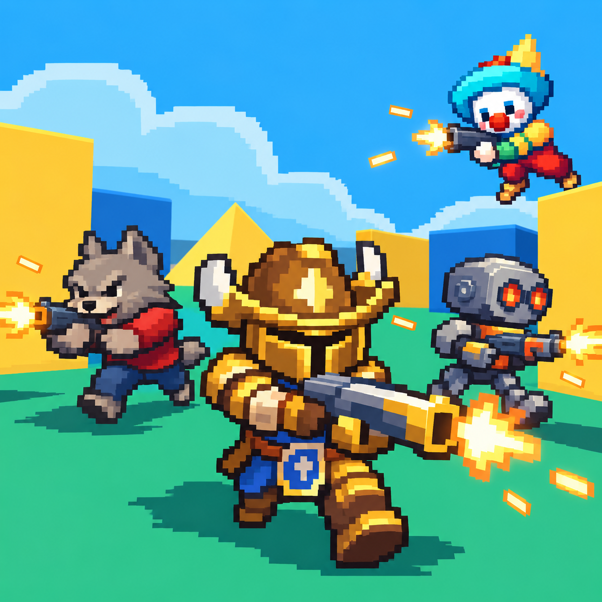
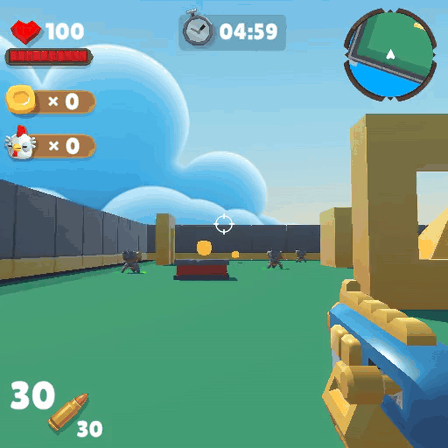
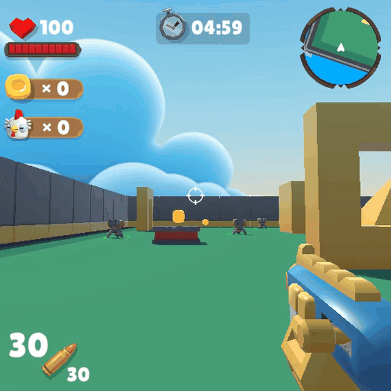
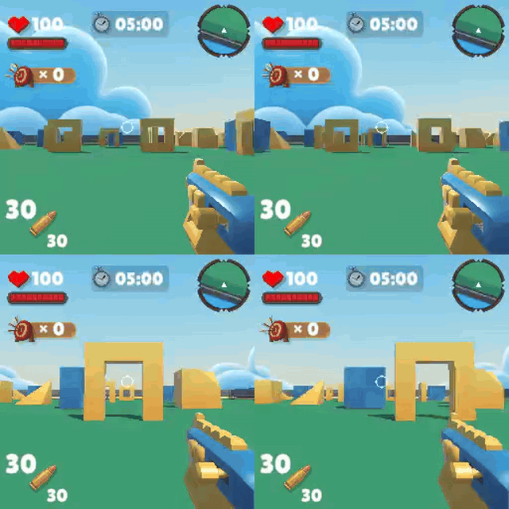

<h1 align="center">
  
  ROAR
</h1>

  
  

<em>These two videos compare the behavior of Gemini-3.1 Pro in the basic single-agent level (goal: collect three coins) under the turn-based setting (left) and the real-time setting (right) with a fixed interval of 40 ms. Under the turn-based setting, the agent can avoid turret attacks through timely movement, whereas under the real-time setting, it is hit by the turret.</em>

  
  

<em>These two videos compare the behaviors of Gemini-3.1 Pro (top two, control the knight) and GPT-5.4 (bottom two, control the clown) in the mixed level (2v2 team battle, goal: defeat all opponents) under the turn-based setting (left) and the real-time setting (right) with a fixed interval of 40 ms. Under the turn-based setting, Gemini-3.1 Pro quickly defeats GPT-5.4 due to its stronger performance. In contrast, under the real-time setting, Gemini-3.1 Pro is eliminated by the toxic zone due to delayed actions.</em>

We are actively working to prepare the relevant code for release. Both the ROAR executable and its accompanying Python code, as well as the code for Multi-Agent Asynchronous Gym, are expected to be released before December 8, 2026, the start date of NeurIPS 2026.