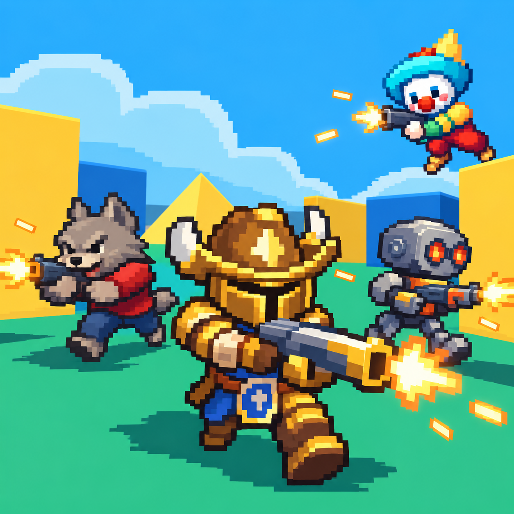
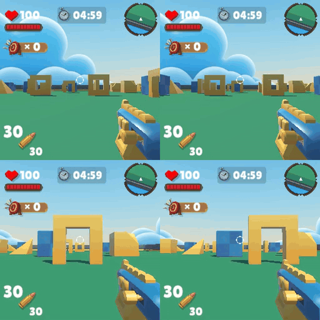

<h1 align="center">
  
  ROAR
</h1>

  
  

<em>These two videos compare the behaviors of Gemini-3.1 Pro (top two) and GPT-5.4 (bottom two) in the mixed level (2v2 team battle) under the turn-based setting (left) and the real-time setting (right) with a fixed interval of 40 ms. Under the turn-based setting, Gemini-3.1 Pro quickly defeats GPT-5.4 due to its stronger performance. In contrast, under the real-time setting, Gemini-3.1 Pro is eliminated by the toxic zone due to delayed actions.</em>

We are actively working to prepare the relevant code for release. The ROAR executable and its accompanying Python code are expected to be released by October 25, 2026, while the code for Multi-Agent Asynchronous Gym is expected to be released by November 1, 2026.